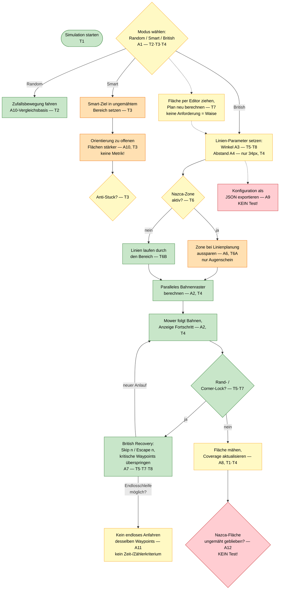
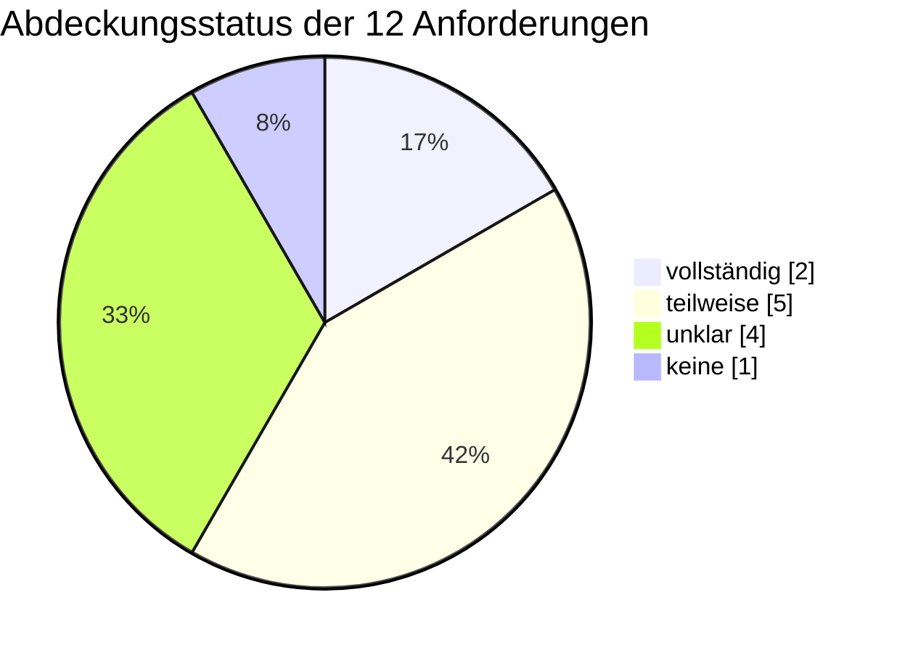

# Traceability-Diagramm – British Garden Mode

**Zweck:** Beleg der drei Risikoaussagen aus der Traceability-Analyse (Testanleitung `Version_korrigiert_1_4_1_british_recovery` vs. Anforderungsdokument `Segway_Idee_British_Garden_Nazca_Navimow`).

**Legende der Farbcodes (Testabdeckung je Funktionsschritt):**

| Farbe | Bedeutung |
|---|---|
| 🟩 / grüne Klasse | **vollständig** – Testfall prüft den Schritt tatsächlich |
| 🟨 / gelbe Klasse | **teilweise** – Schritt wird berührt, aber nicht vollständig geprüft |
| 🟧 / orange Klasse | **unklar** – nur subjektive Beobachtung, kein messbares Kriterium |
| 🟥 / rote Klasse | **keine** – kein Testfall prüft diesen Schritt |

---

## 1. Funktionsfluss British Garden Mode mit Testabdeckungs-Layer

Jeder Knoten zeigt den Code der zugehörigen Anforderung (A1–A12) und die Testfälle, die ihn abdecken (T1–T8).

### Was der Fluss belegt

- **Risikoaussage 1 (JSON-Export ungetestet):** Der rote Knoten `EXPORT` hängt am Funktionsweg, wird aber von keinem Testpfad erreicht.
- **Risikoaussage 2 (Biodiversität ungeschützt):** Der rote Knoten `ZONE` ist der Endpunkt der Funktion – ausgerechnet dort, wo das Kernversprechen „High-Grass bleibt stehen" liegt, verläuft der Flow in eine ungetestete Sackgasse.
- **Risikoaussage 3 (Konfiguration „bedient, nicht verifiziert"):** Die Knoten `PARAM` (Abstand nur 1 Wert) und `SMART2` (subjektiv, ohne Metrik) sind orange – die Verifikation endet vor den eigentlichen Wirksamkeitsprüfungen.
- **Waisen:** Der gestrichelte `EDIT`-Zweig wird getestet (T7), existiert aber im Anforderungsdokument nicht.

---

## 2. Coverage-Heatmap: Anforderungen × Testfälle

| Anforderung | T1 | T2 | T3 | T4 | T5 | T6 | T7 | T8 | Summe-Status |
|---|:-:|:-:|:-:|:-:|:-:|:-:|:-:|:-:|---|
| A1 Umschaltbare Navigation | | 🟨 | 🟨 | 🟨 | | | | 🟨 | 🟨 teilweise |
| A2 Parallele Linien | | | | 🟩 | | | 🟨 | 🟩 | 🟩 vollständig |
| A3 Linienwinkel einstellbar | | | | 🟨 | 🟨 | | | 🟨 | 🟨 teilweise |
| A4 Linienabstand einstellbar | | | | 🟧 | | | | | 🟧 unklar |
| A5 Nazca-Zone optional | 🟨 | | | | | 🟨 | | 🟨 | 🟨 teilweise |
| A6 Aussparung bei Planung | | | | | | 🟧 | | 🟧 | 🟧 unklar |
| A7 Recovery-Logik | | | 🟨 | | 🟩 | | 🟩 | 🟩 | 🟩 vollständig |
| A8 Coverage dauerhaft sichtbar | 🟨 | | | 🟨 | | | | | 🟨 teilweise |
| A9 JSON-Export | | | | | | | | | 🟥 keine |
| A10 Smart-Zielsuche | | 🟨 | 🟧 | | | | | 🟧 | 🟧 unklar |
| A11 Keine Waypoint-Dauerschleife | | | | | 🟨 | | | 🟨 | 🟨 teilweise |
| A12 High-Grass bleibt ungemäht | | | | | | 🟧 | | | 🟧 unklar |

**Waisen (Tests ohne Anforderung):** T1 Teilaspekt Batterie/Heading/Activity-Log · T3 „Smart-Ziel blau" · T4 Anzeige „1/40" · T7 Editor-Neuberechnung · T8 Zeile F (135°, Erwartungsspalte leer).

---

## 3. Abdeckungsverteilung (Überblick)

---

## 4. Direkter Bezug zu den Risikoaussagen

| Risikoaussage | Belegstelle im Diagramm |
|---|---|
| 1. JSON-Export versprochen, aber ungetestet | Roter Knoten `EXPORT` in Abschnitt 1; Zeile A9 in Abschnitt 2 |
| 2. „Biodiversität: High-Grass bleibt stehen" ungeschützt | Roter Knoten `ZONE` (Funktionsendpunkt) in Abschnitt 1; Zeile A12 in Abschnitt 2 |
| 3. Winkel/Abstand „bedient, nicht verifiziert" | Orange Knoten `PARAM` und `SMART2` in Abschnitt 1; Zeilen A3/A4/A10 in Abschnitt 2 |
